<!--
  Public-facing README. This file is the SOURCE for the public repo's README.md.

  MODEL (2026-09-19, binary-only): the public repo `nicglass-overlay` carries only
  this README + GitHub Releases (prebuilt installers); no source is published.
  Issues are ENABLED (owner, 2026-09-26) so players can report bugs publicly; the
  owner folds them into the private repo's tracker as needed. This file is version-controlled here in the private repo and
  carried to the public repo by the release automation (#538) — there is no
  publish/scrub source-mirror pipeline any more (Track B retired). The private repo's
  own dev readme is the repo-root README.md; edit that one for private/dev notes,
  this one for what the public sees.

  Security reports go through GitHub private vulnerability reporting or a Discord DM
  (testers are invited by hand) — no public invite link is published here by design.
  The public repo's .github/ISSUE_TEMPLATE/ forms live only in that repo.

  AUDIENCE: players of every technical level. Every UI label below is quoted exactly
  as the app shows it (verified against widgets/settings.html, widgets/overlay.html,
  widgets/groups.js, widgets/calibration.js, widgets/updateStatus.js,
  src/shell/hotkeys.ts and electron-builder.yml on 2026-10-02, at 0.1.0-beta.9). If
  you rename a button, tab or hotkey in the app, update it here too.

  IMAGES: images/ ships to the public repo next to this file. One shot from #808
  (6a, the Cargo Hold manifest) is still owner-only (taken in game) and is marked
  TODO(#808) below rather than linked, so nothing points at a file that does not
  exist yet.
-->

# NicGlass Overlay

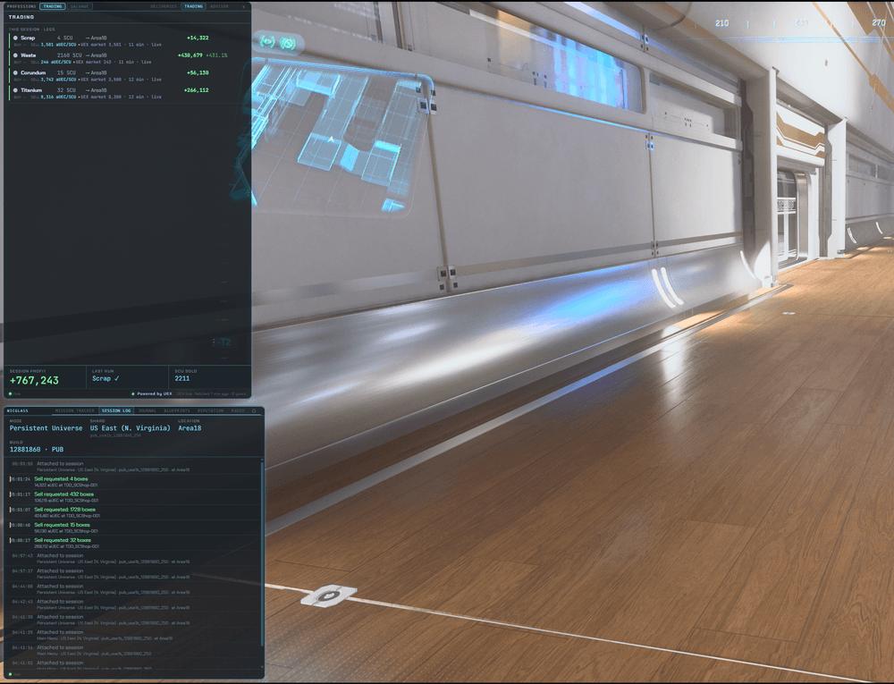

A see-through overlay for **Star Citizen** that sits on top of the game and shows your
missions, cargo, trades, salvage, deliveries and reputation at a glance — without
opening the MobiGlass.

It works by reading the `Game.log` file that Star Citizen already writes to your disk.
It never touches the game itself: no injected code, no memory reading, no automated
input. See **[Is this safe to use?](#is-this-safe-to-use)**.

> An unofficial, fan-made project. Not affiliated with Cloud Imperium Games.
> **This is an early release (v0.1).** Expect rough edges, and please report them (see
> [Bug reports and questions](#bug-reports-and-questions)).

---

## Quick start

If you just want it running, here are the steps. Each one is explained in detail
further down.

1. In Star Citizen, set the display mode to **Borderless** (not Fullscreen).
2. Download **`NicGlass-Overlay-Setup-<version>.exe`** from the
   [Releases](../../releases) page and run it.
3. Launch the overlay, then launch Star Citizen.
4. If Star Citizen is **not** installed in the default folder, press **`Insert`**, open
   **Settings (⚙) → General → Game.log**, click **Browse…**, pick your `Game.log`,
   click **Save**, then restart the overlay.
5. Press **`Insert`** to switch between *click-through* (play the game) and
   *interactive* (click the overlay).

---

## Contents

- [What it shows](#what-it-shows)
- [Before you start](#before-you-start)
- [1. Download](#1-download)
- [2. Install](#2-install)
- [3. First launch](#3-first-launch)
- [4. Point it at your Game.log](#4-point-it-at-your-gamelog)
- [Hotkeys](#hotkeys)
- [Moving and arranging panels](#moving-and-arranging-panels)
- [Optional: OCR (reading numbers off your screen)](#optional-ocr-reading-numbers-off-your-screen)
- [Optional: cloud price sharing](#optional-cloud-price-sharing)
- [Optional: diagnostic logs](#optional-diagnostic-logs)
- [Performance impact](#performance-impact)
- [Troubleshooting](#troubleshooting)
- [Your data, updating and uninstalling](#your-data-updating-and-uninstalling)
- [Bug reports and questions](#bug-reports-and-questions)
- [Is this safe to use?](#is-this-safe-to-use)
- [License](#license)

---

## What it shows

The overlay is a set of panels you can show, hide and rearrange over the game:

- **Mission Tracker** — every active mission, its objectives, reward and reputation
  change.
- **Deliveries** — mission cargo grouped by destination, with SCU per leg.
- **Trading** — your buy-low / sell-high runs with running profit and loss, plus a
  route **Advisor**.
- **Salvage** — claim, wreck and salvaging state, with your rate.
- **Reputation** — your standing with each organisation.
- **Session Log** — travel, economy, mining and death events in one timeline.
- **Journal** — a notepad that is saved between sessions.
- **Blueprints** — crafting-pool progress, with a manual "owned" toggle.
- **Infographics** — reference images you can pop up with a key.
- **Radio** — in-game radio stations.
- **Settings (⚙)** — the Game.log location, updates, hotkeys, appearance, OCR and
  connections.

There is no account to create and nothing to log in to. The overlay reads your
Star Citizen handle from the log. The panels shown adapt to the ship you fly: an
industrial ship brings up Salvage, a cargo ship brings up hauling.

## Before you start

You need:

- **Windows 10 or 11, 64-bit.** There is no Mac or Linux version.
- **Star Citizen installed** on the same PC.
- **Star Citizen set to *Borderless* (or *Windowed*) display mode.** Windows does not
  let anything draw on top of a game running in exclusive *Fullscreen*, so in that
  mode the overlay is running but you can't see it. Change it in Star Citizen's
  **Graphics** settings (**Window Mode → Borderless**).
- **English.** The overlay and its OCR support **English only**: Star Citizen should
  be set to English, and so should Windows. If your Windows uses another language,
  add English as well (see [An OCR reading stays blank](#troubleshooting)).

## 1. Download

1. Go to the [Releases](../../releases) page of this repository.
2. Under the newest release, open **Assets** and download
   **`NicGlass-Overlay-Setup-<version>.exe`**. That is the only file you need.

   You can ignore the other files (`.blockmap`, `latest.yml`). The overlay's
   automatic updates use them behind the scenes.

> Download the newest **regular** release (for example `0.1.0`). Releases marked
> *Pre-release* (versions such as `0.1.0-beta.12`) are beta test builds. You only need
> one of those if you are helping test.

## 2. Install

Double-click `NicGlass-Overlay-Setup-<version>.exe` and follow the steps. It installs
for your Windows user only (no administrator rights needed), lets you choose the
folder, and adds **NicGlass Overlay** shortcuts to your Start menu and desktop.

### "Windows protected your PC"

The overlay isn't code-signed yet (signing certificates are expensive for a free fan
project), so Windows SmartScreen shows a blue warning the first time you run it:

1. Click **More info**.
2. Click **Run anyway**.

You only have to do this once. If you would rather not, wait for a signed release.

## 3. First launch

Start the overlay from the Start menu or the desktop shortcut. You can start it
before or after Star Citizen. It waits for the game either way.

What to expect:

- **It starts in *click-through* mode.** Your mouse goes straight through the overlay
  to the game, so it never gets in the way of flying. To click something on the
  overlay, press **`Insert`**. Press `Insert` again to go back to click-through.
- **The panels appear on your main monitor, then move to Star Citizen's.** Once the
  game is running, the overlay moves to whichever monitor the game is on. The first
  time, the panels sit in their default positions. You can move them (see
  [Moving and arranging panels](#moving-and-arranging-panels)).
- **There is no taskbar button and no tray icon.** This is deliberate, so it stays out
  of Alt-Tab while you play. To close the overlay, press **`Shift` + `Insert`**.
- **Panels fill in once the game produces events.** Each panel shows a small
  connection status: `live` means it is receiving data from your Game.log.

## 4. Point it at your Game.log

The overlay reads Star Citizen's log file. By default it looks here:

```
C:\Program Files\Roberts Space Industries\StarCitizen\LIVE\Game.log
```

**If you installed Star Citizen somewhere else** (another drive, or a custom folder in
the RSI Launcher), tell the overlay where your `Game.log` is:

1. Press **`Insert`** so you can click the overlay.
2. In the **NicGlass** panel, click the **⚙** tab (the last tab) to open **Settings**.
3. On the **General** tab, find the **Game.log** section.
4. Click **Browse…**, go to your Star Citizen folder, open the **`LIVE`** folder, and
   select **`Game.log`**. Windows usually hides the `.log` ending, so the file may
   just be called **`Game`** (a *Text Document*), as below. (You can also type or paste
   the full path into the **Path** box.)
5. Click **Save**. The status line changes to `Saved — takes effect on restart.`
6. Restart the overlay: press **`Shift` + `Insert`** to close it, then start it again.

After the restart, the status line shows `Following:` with your path. If it adds
`— file not found yet (fine if Star Citizen isn't running)`, that's normal before
you've launched the game. The game creates `Game.log` when it starts.

The **⚙** tab (ringed) at the end of the NicGlass panel's tabs opens Settings on the
**General** tab:

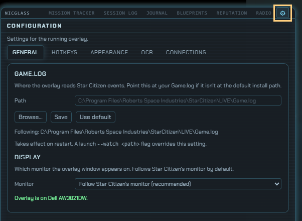

**Browse…** opens a normal Windows file picker. Select the `Game` file inside `LIVE`
and click **Open**:

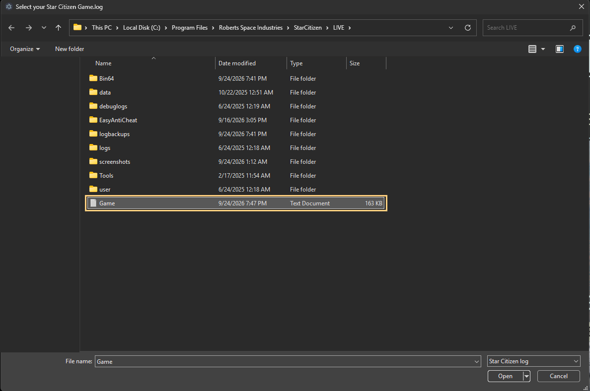 Local Disk (C:) > Program Files > Roberts Space Industries > StarCitizen > LIVE, with the file named Game (a Text Document) selected and ringed.">

**Not sure where Star Citizen is installed?** Open the RSI Launcher and go to
**Settings → Games**. The library folder shown there contains
`StarCitizen\LIVE\Game.log`. For example, a library folder of
`D:\Games\Roberts Space Industries` means your log is at
`D:\Games\Roberts Space Industries\StarCitizen\LIVE\Game.log`.

To go back to the default location, click **Use default** and restart the overlay.

> Playing on the PTU? Browse to the `PTU` folder's `Game.log` instead of `LIVE`.

## Hotkeys

These work while you're in the game. The overlay listens for them without blocking
them, so the key still reaches Star Citizen too. Avoid rebinding them to keys you
use in-game.

| Key | What it does |
|---|---|
| **`Insert`** | Switch between click-through (play) and interactive (click the overlay) |
| **`Shift` + `Insert`** | Close the overlay |
| **`Delete`** | Cycle through the tabs of the main panel |
| **`Shift` + `Delete`** | Move the tab control to the other panel |
| **`Home`** | Show or hide the Professions window (Trading / Salvage) |
| **`End`** | Enter or leave OCR calibration mode (see [OCR](#optional-ocr-reading-numbers-off-your-screen)) |

Each key also works with **`Ctrl`** held. For `Ctrl` + `Home`, use the **right**
`Ctrl`: left `Ctrl` + `Home` also makes your character crouch.

**To change a hotkey:** open **Settings → Hotkeys**, click **Set** next to the action,
and press the new key combination. **Revert** puts the default back.

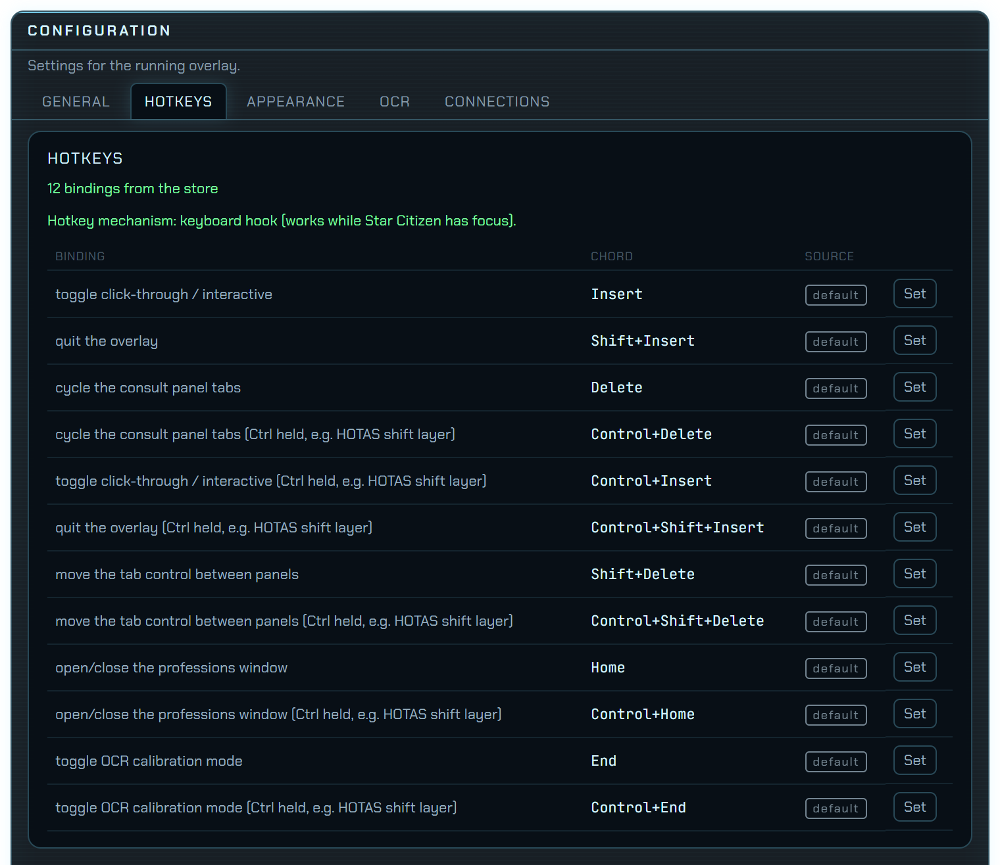

## Moving and arranging panels

1. Press **`Insert`** to make the overlay clickable.
2. Open **Settings (⚙) → Appearance** and click **Unlock** next to **Arranging** (or
   press **`L`** while the overlay is focused). Now you can drag panels to move them
   and drag their edges to resize them.
3. Click **Lock** (or press `L`) when you're done. Your layout is saved.

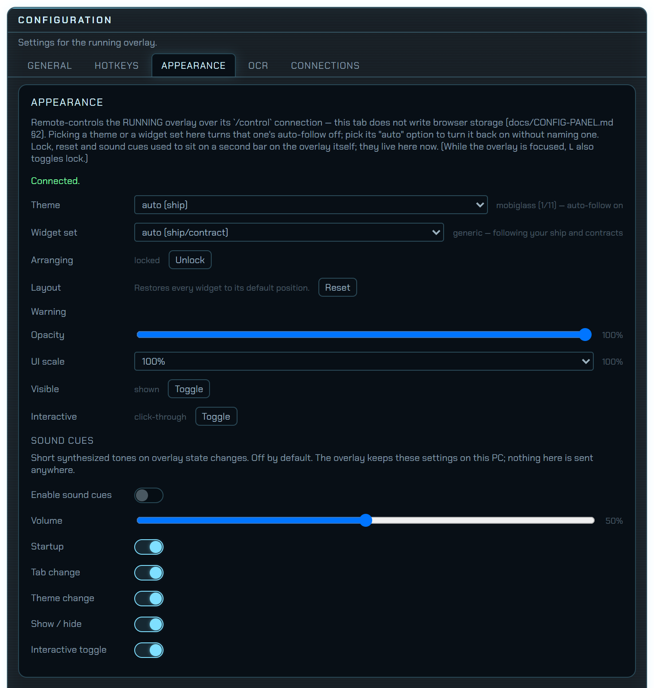

The same **Settings → Appearance** tab has:

- **Layout → Reset** — put every panel back in its default position.
- **Widget set** — which panels are shown. The automatic choice picks panels to suit
  your ship or contract.
- **Theme** and an **Opacity** slider, if the panels are too bright or too faint over
  the game.
- **Sound cues** — optional sounds for events, off until you switch on **Enable sound
  cues**.

---

## Optional: OCR (reading numbers off your screen)

**You can skip this section.** Everything above works without it.

A few useful numbers never appear in `Game.log`. They only exist on your screen:

- your cargo hold's SCU,
- a cargo kiosk's loading time and fee,
- commodity prices on a trade terminal,
- your salvage buffer,
- your reputation rank.

OCR ("optical character recognition") lets the overlay read these numbers off your
screen, the way you would read them yourself. It is **off by default**. When it's on,
it only looks at the Star Citizen window, and only while that window is focused.

### Step 1 — Turn it on

1. Press **`Insert`**, open **Settings (⚙) → OCR**.
2. Switch on **Enable OCR (all features)**.
3. Restart the overlay (**`Shift` + `Insert`**, then start it again).

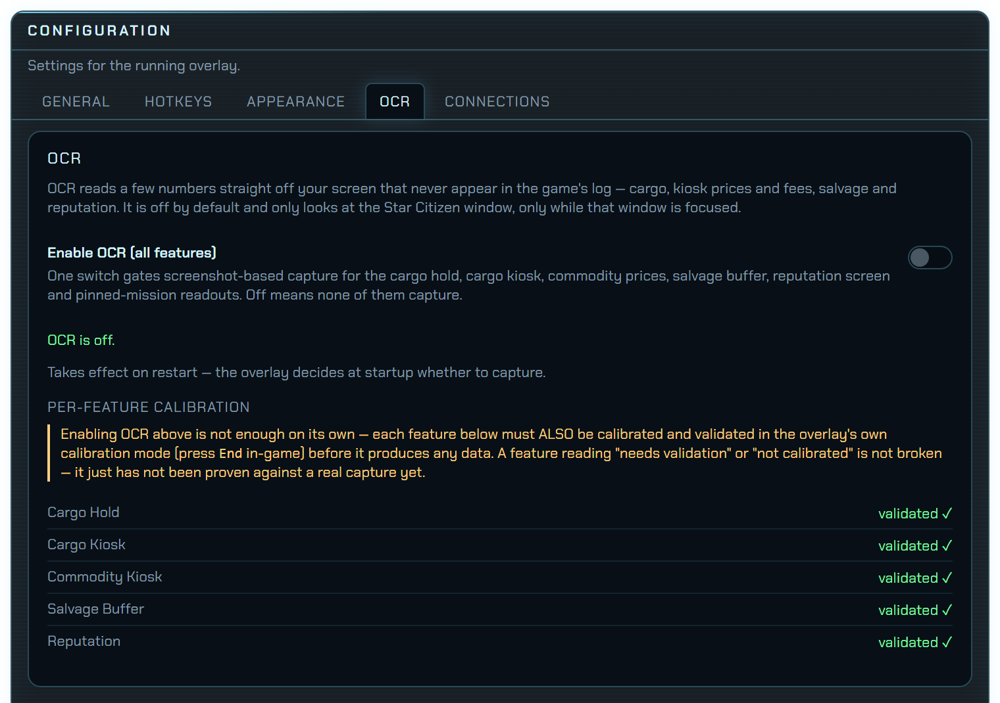

The list at the bottom shows each reading's calibration status. Once you finish Step 2, they all read `validated ✓`, as above.

### Step 2 — Show it where each number is (calibration)

Every screen resolution and HUD layout is different, so you show the overlay where
each number sits on **your** screen. You do this once per reading. **A reading stays
off until you have placed its box and clicked Validate.**

1. Start Star Citizen and get into the game.
2. Press **`End`**. The overlay enters **calibration mode**: one labelled box appears
   for each reading, and a toolbar appears at the top. The toolbar's **Box:** row lets
   you pick which box you're working on.

   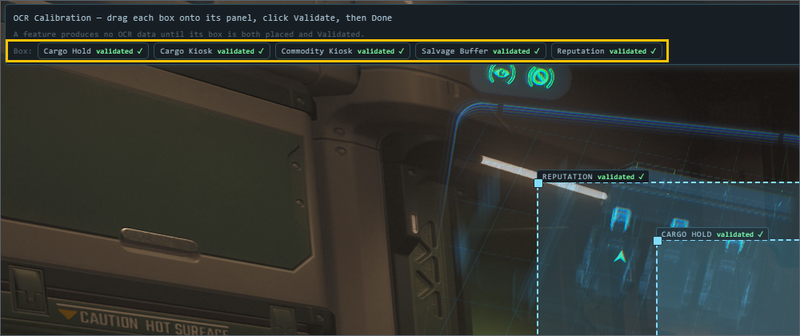

3. In the game, **open the screen that shows the reading** (see the table below).
4. **Drag the box over the number** and resize it by its edges. The box should fully
   contain the text, with a little margin. If the box clips the text, it won't read.
5. Click **Preview**. The box shows what it read, for example `✓ 120 / 696 SCU`. If
   it shows `✗`, adjust the box and try again.
6. Click **Validate**. This saves the box's position and tests it. When it shows
   **`validated ✓`**, that reading is on.
7. Repeat for any other readings you want, then click **Done** (or press `End`) to
   leave calibration mode.

Your boxes are saved and remembered across restarts. Each box's badge tells you
where it stands: `validated ✓`, `needs validation`, or `not calibrated`.

> **Tip:** after a box shows `validated ✓`, don't click **Save**. Saving stores a new
> position, which sets the box back to `needs validation`. Moving a validated box
> does the same. Just click **Validate** again.

| Reading | Open this in-game screen | Put the box around |
|---|---|---|
| **Cargo Hold** | Your ship's cargo-hold / vehicle-inventory **manifest**, with some cargo aboard | The hold's `current / max SCU` total, e.g. `120 / 696 SCU`. Use the manifest's total, **not** the kiosk's item list |
| **Cargo Kiosk** | At a commodity terminal, pick a commodity and press **Buy** to open the **Confirmation** dialog (then **Cancel**; you don't have to buy) | Both the `EST. LOADING TIME` line **and** the `CARGO AUTO-LOAD: ¤…` line, together |
| **Commodity Kiosk** | A commodity terminal's Buy / Local Market Value list | The **rows of commodities and prices**. Leave out the header and filter buttons |
| **Salvage Buffer** | Sitting in a salvage ship (e.g. a Vulture), looking at the salvage HUD | The word `DEPOT` **and** its `x / y SCU` value together. An empty `0.0 / 13.0 SCU` is fine |
| **Reputation** | MobiGlass → **Reputation**, on an organisation where your current rank tile is highlighted | The **row of rank tiles**, with your highlighted tile fully inside. The overlay picks out the highlighted one |

Here is what a validated box looks like on those screens (the ringed part is what the reading needs):

<!-- TODO(#808, owner shot 6a): Cargo Hold box over the ship manifest's
     `current / max SCU` total, with cargo aboard. Save as images/ocr-cargo-hold.png
     (≤1000 px wide, no personal data), then replace this comment with:
      -->

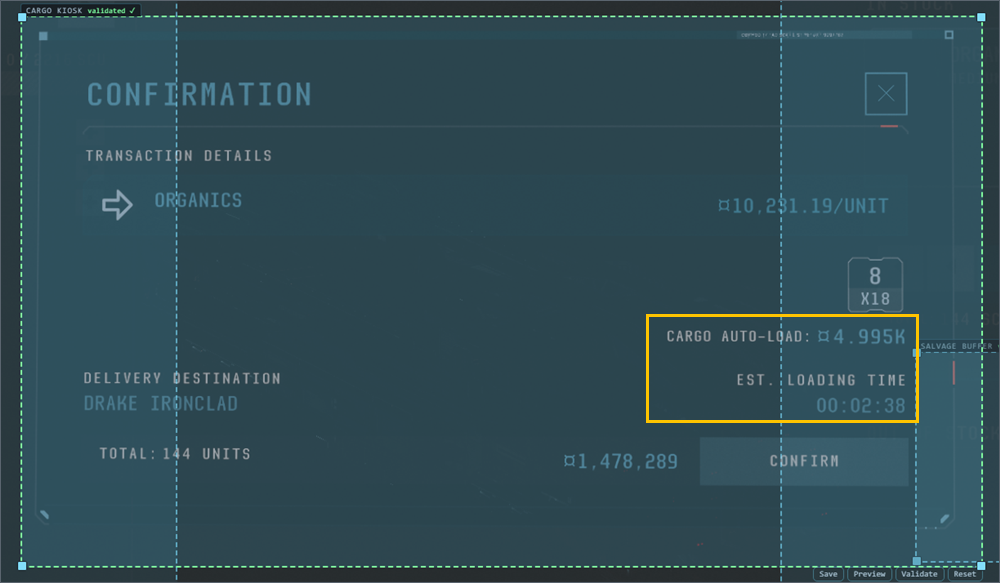

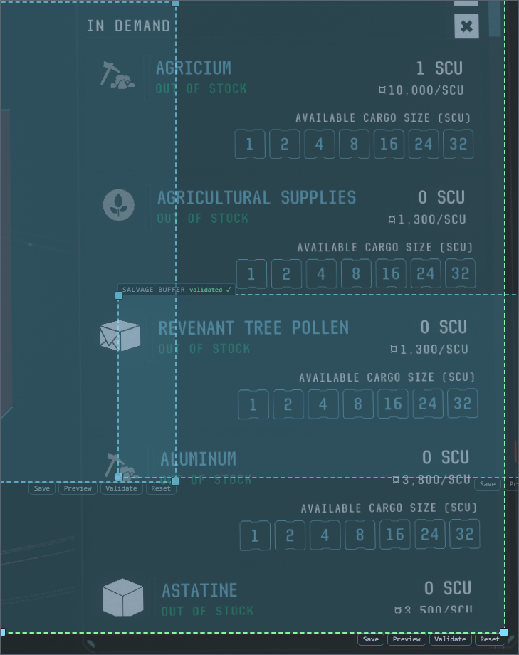

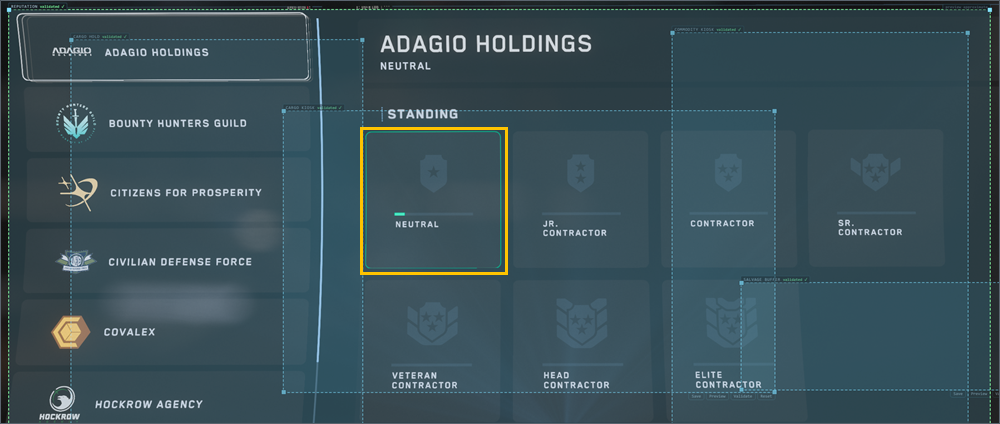

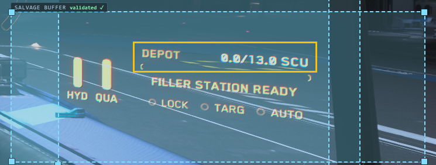


A slightly generous box is fine, and nearby HUD text doesn't confuse it. Just don't make
the box so big that it catches a *second*, similar-looking number.

**Flying more than one ship?** The cargo hold and salvage HUD sit in different places
on different ships, but each reading remembers only one box. After switching ships,
check those two boxes and re-validate if needed.

A couple of OCR features (reading your pinned mission) need no box at all. Turning on
OCR in Step 1 is enough for them.

---

## Optional: cloud price sharing

**You can skip this section too.** It's off unless you turn it on.

Every time you buy or sell, the overlay records the price. These prices always stay on
your PC and feed the trade Advisor. If you like, you can also share them with other
players, and use theirs, through a shared community price database:

1. Open **Settings → Connections** and click **Link account**.
2. Your browser opens so you can sign in and approve the link. Come back to the overlay
   when you're done.
3. Choose what to share. Both switches start **off**:
   - **Share my market data** — upload the prices you see.
   - **Use community prices** — let other players' prices inform your Advisor.

Price sharing only ever sends market prices. Your journal, purchase ledger and session
history stay on your PC; the only way your logs leave it is the separate
[diagnostic logs](#optional-diagnostic-logs) setting. **Unlink** disconnects at any
time.

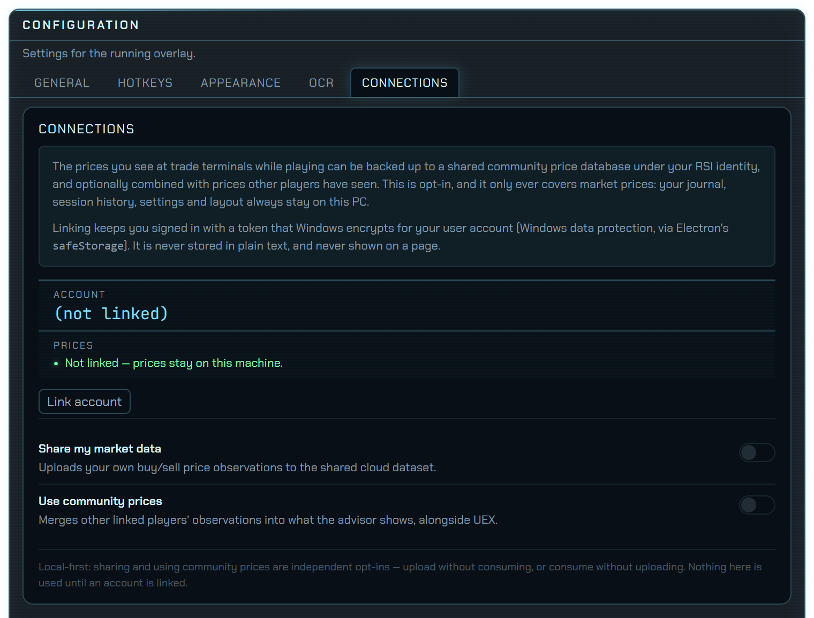

**Known limitation:** sharing prices between players is new. Uploading and reading
back your own prices is tested, but the full exchange between two real players'
accounts has not been exercised yet; it is still being verified. If a
shared price looks wrong, please report it.

## Optional: diagnostic logs

With an account linked, the overlay can send your log files to the developer so bugs
can be found without you having to hunt for files or describe a session. This is a
separate setting in Settings → Connections, independent of price sharing.

- **Default:** **off** in public releases — nothing is sent unless you turn on
  **Share diagnostic logs**. Beta builds (a `-beta` version) start with it on, and
  show a notice the first time you link an account that says what is sent and lets
  you turn it off with one click. Nothing is sent before that notice is dismissed,
  and your own choice always wins. Nothing is ever sent without a linked account.
- **When:** in the background shortly after the overlay starts, and periodically after
  that. Each file is sent once. **Send logs now** sends the same files plus the
  session in progress, and shows an upload ID you can paste into a bug report.
- **What is sent:**
  - your Star Citizen `Game.log` sessions from the last 14 days — your handle and RSI
    account ID, the handles of players near you, locations, play times, and your
    PC's hardware and Windows version;
  - the overlay's own log, including the readings it made from your screen (prices,
    mission titles, reputation).
- **Removed before sending:** your PC's name, its network addresses, your Windows
  user name and home folder, and any screen text the overlay read but could not
  recognise (it could be chat or other players' names). Screenshots and OCR
  captures are never sent. Your own copy of the log on your PC keeps everything.
- **Where it goes and for how long:** a private storage bucket (Amazon S3, US East)
  that only the developer can read. Uploads are deleted from it automatically **90
  days** after upload. The developer may keep a local copy of a session while
  working on the bug it shows, and deletes it when that bug is closed.
- **Who sent it:** so that sessions from the same tester can be followed across
  uploads, the developer keeps a short private list that pairs your account ID and
  RSI handle with a label (`Tester A`, `Tester B`, …). It holds nothing from your
  logs, and it is used only for testing. Discord upload notices show the label, never
  your handle. The list does not expire on its own; ask the developer to remove your
  entry at any time.
- **Why:** to reproduce and fix bugs in the overlay. The logs are not shared,
  published or used for anything else.

Turning the setting off stops future uploads. To have files that were already sent
deleted sooner, send the developer your upload ID — a Discord direct message if you
are a tester, or a GitHub issue that gives only the upload ID, not your handle.

## Performance impact

We measure the overlay's cost to the game with PresentMon, watching Star Citizen's own
frames. Each run is 90 seconds in the same hangar scene, and the three setups are
compared within a single run. Test PC: RTX 4080 Super at 3840×1600 (measured
2026-09-28).

| Setup | Avg FPS vs. no overlay | 1% low vs. no overlay | Frames over 100 ms |
|---|---|---|---|
| Overlay off | — (70.9 fps) | — (34.1 fps) | 0 |
| Overlay on, OCR off | **−4.5%** (67.7) | −1.5% (33.6) | 0 |
| Overlay on, OCR on | **−7.3%** (65.7) | −11.4% (30.2) | 0 |

- The game stays in hardware "independent flip" presentation with the overlay open, so
  the transparent window doesn't force slower desktop composition.
- OCR reads the screen every few seconds, one reading at a time, on a single background
  process. It adds about 2% of total CPU. OCR doesn't cause periodic hitches: the
  longest frame in the OCR run was 69 ms, against 60 ms with no overlay.
- These figures come from one machine. The 1% low varies by a few percent between runs
  on its own. A slower CPU will likely feel OCR more. If you notice stutter, turn OCR
  off in **Settings → OCR** (takes effect after an overlay restart) and please report it.

---

## Troubleshooting

<details>
<summary><b>I can't see the overlay at all</b></summary>

- Check Star Citizen's display mode. It must be **Borderless** or **Windowed**, not
  Fullscreen (see [Before you start](#before-you-start)).
- Is the overlay on a different monitor from the game? See the next item.
- Did you close it with `Shift` + `Insert`? Start it again from the Start menu.

</details>

<details>
<summary><b>The game is on a different monitor from the overlay</b></summary>

By default the overlay follows Star Citizen to whichever monitor it's on. If it
doesn't:

1. Press **`Insert`**, open **Settings (⚙) → General**, and find the **Display**
   section.
2. Choose **Follow Star Citizen's monitor (recommended)**, or pick the monitor you
   want by name. The overlay moves straight away, no restart needed.

</details>

<details>
<summary><b>The panels stay empty / never show "live"</b></summary>

- Is Star Citizen running and are you in the game? Panels fill in from events in the
  log.
- Check **Settings → General → Game.log**. The status line should say `Following:`
  followed by the correct path. If the path is wrong, see
  [Point it at your Game.log](#4-point-it-at-your-gamelog). Remember to restart the
  overlay after changing it.

</details>

<details>
<summary><b>My mouse clicks go through the overlay / the overlay is blocking my clicks</b></summary>

Press **`Insert`**. It switches between click-through (clicks go to the game) and
interactive (clicks go to the overlay).

</details>

<details>
<summary><b>An OCR reading stays blank</b></summary>

- Is its box **`validated ✓`**? A box that is only placed (or only saved) produces
  nothing. Press `End` and check the badge.
- Is the right in-game screen open, and is Star Citizen the focused window? OCR
  pauses whenever you tab out.
- Did you restart the overlay after switching on **Enable OCR (all features)**?
- Clicking **Preview** or **Validate** shows `game window not found — open Star
  Citizen`: the game isn't running, or it's minimised.
- OCR supports **English only**. It uses Windows' built-in text recognition, which
  needs English installed in Windows. If Windows uses another language, add
  **English** under Windows **Settings → Time & language → Language & region**, and
  make sure Star Citizen itself is set to English.

</details>

<details>
<summary><b>Something else is wrong</b></summary>

The overlay keeps a log file you can share when asking for help:

```
%USERPROFILE%\.sc-companion\logs\overlay.log
```

Paste that path into the File Explorer address bar to open it. If you have
[diagnostic logs](#optional-diagnostic-logs) on, **Send logs now** in
**Settings → Connections** sends it for you and gives you an upload ID to quote
instead. See [Bug reports and questions](#bug-reports-and-questions).

</details>

---

## Your data, updating and uninstalling

**Where your data lives:** everything the overlay saves is kept in your user folder at
`%USERPROFILE%\.sc-companion`. That includes your journal, session history, prices,
settings, hotkeys and OCR boxes. Nothing is stored inside the program's own folder.

**Updating:** the overlay updates itself. It checks this repository's Releases for a
newer build and downloads it in the background. When it's ready, a banner says
`Update <version> ready` with **Restart now** and **Later**. If you pick Later, the
update installs the next time you close the overlay. Your data and settings are kept.

- To check by hand, open **Settings (⚙) → General → Updates** and click **Check now**.
  The same section shows the version you're running.
- **Receive beta (pre-release) updates** in that section decides whether you get beta
  builds. Until you change it, it is on while you run a beta build and off while you
  run a regular release, so a beta that updates to a regular release stops getting
  betas unless you turn this on.
- If a banner says this version is known not to work with the current game patch,
  click **Restart to update**.

You can also update by hand at any time: download the newest installer from
[Releases](../../releases) and run it over the old version.

**Uninstalling:** use Windows **Settings → Apps → Installed apps → NicGlass Overlay →
Uninstall**. Your data folder is **not** removed automatically. Delete
`%USERPROFILE%\.sc-companion` yourself if you want a completely clean slate.

## Bug reports and questions

Found a bug or have an idea? **[Open an issue](../../issues/new/choose)** — there are
forms for bug reports and feature requests. Testers on the community Discord can keep
reporting there too.

When you report a bug, it helps to say what you were doing, what you expected, and
what happened instead. If you use [diagnostic logs](#optional-diagnostic-logs),
include the upload ID from **Send logs now**.

Please **don't attach raw `Game.log` or `overlay.log` files** to an issue. Issues are
public, and the logs carry your handle and session detail. Paste only the few lines
around the problem, and blank out your handle if you'd rather keep it private.

Suspected **security** issues should not go in a public issue — see
[SECURITY.md](SECURITY.md).

## Is this safe to use?

**It only reads files.** The overlay reads the `Game.log` file the game writes to
disk. It never injects code, hooks the game process, reads game memory, or presses
keys or clicks for you. Its hotkeys only *listen*: every key still reaches the game
as normal.

**OCR is just a screenshot.** Optional OCR (off by default) captures the Star Citizen
window only, and only while that window is focused. It reads the same numbers you
can see.

**Not affiliated with Cloud Imperium Games.** Star Citizen and all related marks are
the property of CIG / Roberts Space Industries. This is an unofficial, fan-made tool
with no endorsement or affiliation. Use it in line with CIG's Terms of Service and
EULA; you are responsible for how you use it.

**No warranty.** The software is provided "as is", without warranty of any kind, and
without any guarantee that it is compatible with, or permitted by, any third-party
service including Star Citizen. You use it at your own risk. See the
[LICENSE](LICENSE) for the full disclaimer and limitation of liability.

## License

**Proprietary end-user license — see [LICENSE](LICENSE).** NicGlass Overlay is free
for your personal use. You may not redistribute, resell or reverse-engineer it, apart
from the standard carve-outs for the bundled open-source components below and for
rights the law does not let a license exclude. This is a closed-collaboration project:
the source is not published.

**Third-party components.** The build bundles third-party software under its own
licenses, with the required notices in **[THIRD-PARTY-NOTICES](THIRD-PARTY-NOTICES)**:

- the low-level input hook uses `libuiohook` (LGPL-3.0-or-later) via `uiohook-napi`
  (MIT), shipped as a separately loadable native library per the LGPL's
  shared-library terms;
- optional cloud sync uses the AWS SDK / Smithy packages (Apache-2.0);
- the UI typefaces (Chakra Petch, JetBrains Mono) are under the SIL Open Font
  License 1.1.

**Data sources.** Some of the bundled ship, mission and drive data comes from
the [Star Citizen Wiki API](https://api.star-citizen.wiki). Trade-terminal data and the
optional live prices come from [UEX Corp](https://uexcorp.space). Thanks to both
communities. The rest is read from the game's own files. Details are in
[THIRD-PARTY-NOTICES](THIRD-PARTY-NOTICES).
